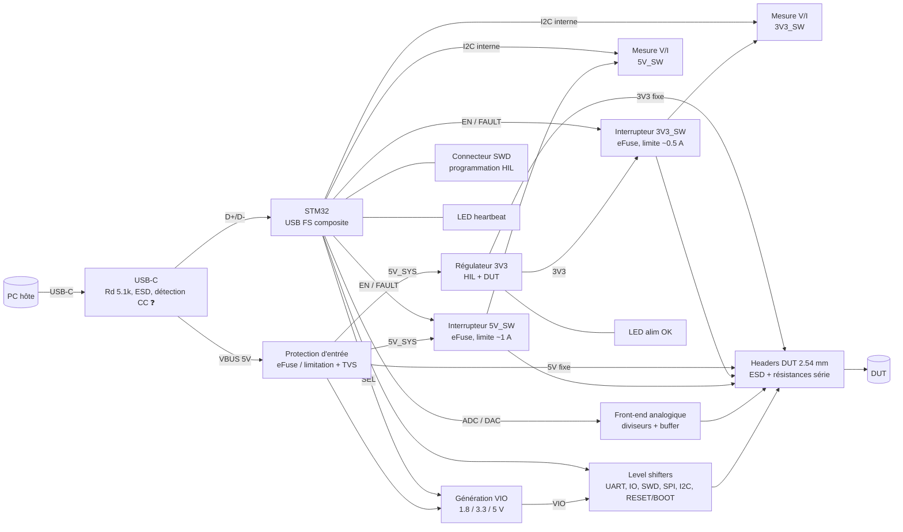

# SPEC — OOTY (rev A)

Carte **HIL (Hardware-In-the-Loop)** pilotée en USB depuis un PC. Elle permet à un humain ou à un agent (Claude) de tester un **DUT** (Device Under Test) à distance : l'alimenter et le couper, le flasher et le debugger, mesurer sa consommation, piloter et lire ses IO, et dialoguer avec lui en UART, I2C ou SPI.

> Statut : **brouillon Phase 0, à valider** (checkpoint). Les points marqués ❓ sont des propositions à confirmer.

---

## 1. Cas d'usage

1. **Hard reboot** du DUT : couper puis rétablir 3V3_SW et/ou 5V_SW.
2. **Flash et debug** du DUT en SWD (sonde CMSIS-DAP intégrée), sans sonde externe.
3. **Reset doux et bootloader** : piloter RESET et BOOT du DUT (ESP32 EN/IO0, STM32 NRST/BOOT0…).
4. **Console** : UART du DUT exposé côté PC comme port série virtuel.
5. **Mesure de consommation** : tension, courant et puissance sur les rails commutés (démarrage, plantage, veille, court-circuit).
6. **Stimuli et observation** : 4 sorties et 4 entrées numériques, entrées analogiques, sortie analogique (DAC), bus I2C et SPI.
7. **Robustesse** : un DUT en court-circuit ou une mauvaise manipulation ne doit endommager ni la carte ni le port USB du PC.

## 2. Blocs fonctionnels

| Bloc | Rôle | Exigences clés |
|---|---|---|
| USB-C | Alimentation et données | USB 2.0 Full Speed (12 Mbit/s), Rd 5.1 kΩ sur CC1/CC2 (sink), ESD sur D+/D-/VBUS. ❓ Lecture des tensions CC par l'ADC pour connaître le courant annoncé par la source (0.5 / 1.5 / 3 A). |
| Protection d'entrée | Protéger le port USB du PC | Limitation du courant total tiré sur VBUS, TVS sur VBUS, protection contre l'inversion inutile (USB-C détrompé). |
| Régulateur 3V3 | Logique HIL + rails 3V3 du DUT | ≥ 1 A en sortie. Un convertisseur buck est envisagé (dissipation d'un LDO 5→3.3 V à 0.8 A ≈ 1.4 W, trop élevée). Choix en Phase 1. |
| Rails commutés 3V3_SW / 5V_SW | Hard reboot du DUT | Load switch / eFuse avec limitation de courant, enable piloté par le MCU, flag FAULT relu par le MCU, décharge de sortie (vrai 0 V à l'arrêt), état OFF au démarrage du MCU. |
| Mesure V/I | Consommation du DUT | Un moniteur par rail commuté (INA226 ou INA228 envisagés, choix en Phase 1), shunt côté haut, bus I2C **interne** (séparé de l'I2C exposé au DUT). |
| VIO | Tension des signaux côté DUT | 1.8 / 3.3 / 5 V sélectionnable par logiciel. ❓ Option « VIO externe » = tension de référence fournie par le DUT (VTref, comme une sonde de debug classique). |
| Level shifters | Adapter 3V3 (MCU) ↔ VIO (DUT) | Lignes unidirectionnelles : buffers à direction fixe (famille 74LVC1T45/LVC8T245, 1.65–5.5 V). SWDIO : direction pilotée par le MCU. I2C : translateur open-drain (PCA9306 ou équivalent). Sortie haute impédance (OE) tant que VIO n'est pas établi. |
| RESET / BOOT | Reset doux, bootloader | Sorties **open-drain** (le DUT garde ses propres pull-ups), compatibles toutes tensions VIO. |
| Sonde SWD DUT | Flash/debug | Firmware CMSIS-DAP sur le STM32. Signaux SWCLK, SWDIO, SWO, nRESET (= ligne RESET). |
| Analogique | Mesures et stimuli | ❓ 2 entrées ADC 0–5 V (diviseur + filtre, impédance d'entrée ≥ 100 kΩ). ❓ 1 sortie DAC 0–3.3 V bufferisée (AOP), courant ≥ 5 mA. |
| MCU STM32 | Contrôle + USB | USB FS sans quartz (HSI48 + CRS) ou avec quartz, DAC, ≥ 2 ADC libres, 2× I2C, SPI, 2× UART, ≥ 128 KiB flash. Candidats à évaluer en Phase 1 : STM32G0B1, STM32F072, STM32G431. |
| Debug HIL | Programmer la carte elle-même | Connecteur SWD ARM Cortex 10 broches 1.27 mm (compatible ST-Link V3 / J-Link). Le bootloader USB DFU intégré reste une solution de secours (BOOT0 accessible). |
| LED | État | LED « alim OK » câblée directement sur 3V3. LED « heartbeat » pilotée par le firmware. |

## 3. Budget de puissance

### Limites par rail (proposition ❓)

| Rail | Source | Courant max DUT | Protection |
|---|---|---|---|
| 5V (fixe) | VBUS via protection d'entrée | 0.5 A | Limitation de l'entrée |
| 5V_SW | VBUS via eFuse | 1.0 A | eFuse, limite ~1.1 A |
| 3V3 (fixe) | Régulateur 3V3 | 0.3 A | Limitation du régulateur |
| 3V3_SW | Régulateur 3V3 via eFuse | 0.5 A | eFuse, limite ~0.55 A |

### Consommation de la carte HIL seule (estimation)

| Poste | Courant @3V3 |
|---|---|
| STM32 (USB actif, cœur à fond) | ~40 mA |
| Level shifters, INA, AOP | ~10 mA |
| LED (2 × ~2 mA) | ~4 mA |
| **Total HIL** | **~55 mA @3V3 ≈ 45 mA @5V** (buck η ≈ 85 %) |

### Pire cas sur VBUS
- DUT 5V : 0.5 + 1.0 = 1.5 A
- DUT 3V3 : 0.8 A @3V3 → ≈ 0.62 A @5V (η ≈ 85 %)
- HIL : ≈ 0.05 A
- **Total ≈ 2.2 A @5V** → nécessite une source USB-C annonçant **3 A**.

Conséquence : sur un port USB 2.0 classique (0.5 A) ou une source 1.5 A, le budget du DUT est réduit. ❓ Le firmware lit le courant annoncé sur CC et refuse d'activer des rails au-delà de la capacité de la source (nécessite la lecture CC par l'ADC, voir §2).

## 4. Interfaces et connecteurs DUT

Tous les connecteurs DUT sont des **headers mâles 2.54 mm**, groupés sur un même bord, avec la sérigraphie de chaque broche. Chaque broche exposée a une protection **ESD (TVS)** et une **résistance série** (signaux) adaptée à sa fonction.

| Connecteur | Broches (proposition) |
|---|---|
| J_PWR | 5V, 5V_SW, 3V3, 3V3_SW, VIO, GND ×2 |
| J_DBG (SWD DUT) | VIO/VTref, SWDIO, SWCLK, SWO, RESET, BOOT, GND |
| J_UART | TX, RX, GND |
| J_IO | IN1..IN4, OUT1..OUT4, GND ×2 |
| J_BUS | I2C SDA, SCL, SPI SCK, MOSI, MISO, CS, GND |
| J_ANA | AIN1, AIN2, AOUT, GND |

Le nombre exact et l'ordre des broches seront figés en Phase 2 (schéma).

### Budget de broches MCU (estimation)

| Fonction | Broches |
|---|---|
| USB D+/D- | 2 |
| SWD de la carte HIL (SWDIO, SWCLK, NRST, BOOT0) | dédiées |
| Sonde SWD DUT (SWCLK, SWDIO, SWDIO_DIR, SWO) | 4 |
| RESET, BOOT DUT | 2 |
| UART DUT | 2 |
| IN ×4 + OUT ×4 | 8 |
| I2C DUT + SPI DUT | 2 + 4 |
| I2C interne (INA) + ALERT | 3 |
| EN + FAULT des 2 interrupteurs | 4 |
| Sélection VIO + OE level shifters | 3 |
| ADC ×2 + DAC ×1 | 3 |
| Lecture CC1/CC2 ❓ | 2 |
| LED heartbeat | 1 |
| **Total** | **~40** → boîtier 48 broches au minimum, 64 broches pour la marge |

## 5. Logiciel (hors PCB, impacte le choix du MCU)

- USB composite : CDC « contrôle » (commandes texte simples) + CDC « UART DUT » + CMSIS-DAP v2 (bulk).
- Protocole de commande simple et documenté, utilisable par une lib Python et, à terme, par un serveur MCP pour Claude.
- Le firmware n'est **pas** dans le périmètre de ce projet KiCad ; ces besoins fixent seulement la taille mémoire et les périphériques du MCU.

## 6. Contraintes mécaniques

| Paramètre | Valeur |
|---|---|
| Dimensions | **85 × 55 mm max**, objectif ~70 × 50 mm |
| Fixation | ❓ 4 trous M3 (Ø 3.2 mm) aux coins, à 3.5 mm des bords |
| Hauteur | ❓ Pas de boîtier prévu → pas de contrainte de hauteur |
| USB-C | Sur un petit côté |
| Connecteurs DUT | Sur le côté opposé ou le grand côté, broches lisibles en sérigraphie |
| Connecteur SWD HIL | Accessible, sans gêner les connecteurs DUT |
| LED | Visibles du dessus (contrôle par webcam) |
| Composants | Une seule face (dessus) si possible, pour l'assemblage le moins cher |

## 7. Fabrication

- **Fabricant recommandé : JLCPCB** (PCB + assemblage). Voir `NOTES.md` pour la comparaison avec PCBWay. ❓ À confirmer.
- **Couches : 4** (Signal / GND / Power / Signal). Voir `NOTES.md`.
- **Règles de conception (conservatrices, au-dessus des minima JLCPCB)** :

| Paramètre | Valeur retenue | Minimum JLCPCB (4 couches) |
|---|---|---|
| Piste / espace signal | 0.15 / 0.15 mm | 0.09 / 0.09 mm |
| Via | Ø perçage 0.3 mm / pad 0.6 mm | 0.2 / 0.45 mm |
| Épaisseur | 1.6 mm | — |
| Stack-up | Standard JLCPCB 4 couches 1.6 mm (JLC04161H-7628), à confirmer en Phase 3 | — |
| Cuivre | 1 oz externes, 0.5 oz internes | — |
| Finition | HASL sans plomb (ENIG si pas fin) | — |

- Les minima JLCPCB proviennent de leur page de capacités ; ils seront revérifiés en Phase 3 avant de figer les règles.
- **USB Full Speed** (12 Mbit/s) : impédance contrôlée 90 Ω non critique à cette vitesse et sur quelques mm ; on route quand même la paire D+/D- en différentiel, courte et au-dessus du plan GND.
- Composants CMS 0402 minimum (0603 préféré pour les passifs), pièces « Basic » JLCPCB en priorité pour éviter les frais de pièces « Extended ».

## 8. Hors périmètre rev A

IO multifonctions configurables, LED par IO, entrée d'alimentation externe / USB-PD, isolation galvanique USB, switch USB du DUT, numéro de série personnalisé, watchdog côté hôte.

## 9. Points à valider au checkpoint

1. ❓ Lecture des lignes CC pour connaître le courant disponible (2 broches ADC, quelques résistances).
2. ❓ Limites de courant : 5V 0.5 A, 5V_SW 1 A, 3V3 0.3 A, 3V3_SW 0.5 A.
3. ❓ Analogique : 2 entrées ADC 0–5 V et 1 sortie DAC 0–3.3 V.
4. ❓ Option VIO externe (VTref du DUT) en plus de 1.8 / 3.3 / 5 V.
5. ❓ 4 trous M3, pas de contrainte de hauteur.
6. ❓ JLCPCB plutôt que PCBWay.
7. ❓ 4 couches.
