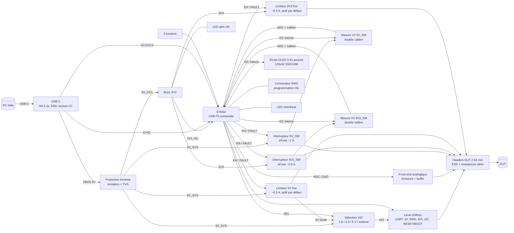

# SPEC — OOTY (rev A)

Carte **HIL (Hardware-In-the-Loop)** pilotée en USB depuis un PC. Elle permet à un humain ou à un agent (Claude) de tester un **DUT** (Device Under Test) à distance : l'alimenter et le couper, le flasher et le debugger, mesurer sa consommation, piloter et lire ses IO, et dialoguer avec lui en UART, I2C ou SPI.

> Statut : **validée au checkpoint Phase 0 (2026-10-19)**, avec l'ajout d'un petit écran I2C.

---

## 1. Cas d'usage

1. **Hard reboot** du DUT : couper puis rétablir 3V3_SW et/ou 5V_SW.
2. **Flash et debug** du DUT en SWD (sonde CMSIS-DAP intégrée), sans sonde externe.
3. **Reset doux et bootloader** : piloter RESET et BOOT du DUT (ESP32 EN/IO0, STM32 NRST/BOOT0…).
4. **Console** : UART du DUT exposé côté PC comme port série virtuel.
5. **Mesure de consommation** : tension, courant et puissance sur les rails commutés (démarrage, plantage, veille, court-circuit).
6. **Stimuli et observation** : 4 sorties et 4 entrées numériques, 2 entrées analogiques, 1 sortie analogique (DAC), bus I2C et SPI.
7. **État visible d'un coup d'œil** (sur place ou par webcam) : petit écran (consommation, état des rails, VIO, défauts) et LED.
8. **Robustesse** : un DUT en court-circuit, même sur un rail fixe, ne doit endommager ni la carte ni le port USB du PC, et ne doit **jamais** faire perdre la main sur la carte HIL.

## 2. Blocs fonctionnels

| Bloc | Rôle | Exigences clés |
|---|---|---|
| USB-C | Alimentation et données | USB 2.0 Full Speed (12 Mbit/s), Rd 5.1 kΩ sur CC1/CC2 (sink), ESD sur D+/D-/VBUS. **Lecture des tensions CC1/CC2 par l'ADC** pour connaître le courant annoncé par la source (défaut USB / 1.5 A / 3 A). |
| Protection d'entrée | Protéger le port USB du PC | Limitation du courant total tiré sur VBUS, TVS sur VBUS. Pas de protection contre l'inversion de polarité (inutile, USB-C détrompé). |
| Buck 3V3 | Logique HIL + rails 3V3 du DUT | ≥ 1.5 A en sortie, pour garder de la marge sur une charge max ≈ 0.87 A (un LDO dissiperait ≈ 1.5 W, voir `NOTES.md`). Choix du composant en Phase 1. |
| Rails fixes 5V / 3V3 | Alimenter le DUT en permanence | **Tension relue par l'ADC** (diviseur ×0.5). **Limiteur de courant** sur chaque rail fixe, **actif dès la mise sous tension** (EN tiré à l'état actif) mais **coupable par le firmware** (budget USB insuffisant, FAULT persistant), flag FAULT relu par le MCU. Un court-circuit sur un rail fixe ne fait pas tomber le 3V3 de la carte HIL. Les rails 5 V ne sont pas régulés : ≈ 4.45 V au pire cas (VBUS 4.75 V moins les chutes du PTC, du limiteur et du shunt ; ≈ 4.30 V sur 5V_SW en calibre fort), avant la chute du câble USB. |
| Rails commutés 3V3_SW / 5V_SW | Hard reboot du DUT | Load switch / eFuse avec limitation de courant, enable piloté par le MCU, flag FAULT relu par le MCU, décharge de sortie (vrai 0 V à l'arrêt), état OFF au démarrage du MCU. |
| Mesure V/I | Consommation du DUT | **Double calibre** sur chaque rail commuté : shunt fin 100 Ω (veille, **0.1 µA de résolution, de ~1 µA à ≥ 0.22 mA**, 0.33 mA typ.) court-circuité par un MOSFET dès que la chute dépasse le seuil, **bascule matérielle en ≈ 1 µs** (comparateur + bascule D), retour au calibre fin ou maintien en calibre fort commandés par le firmware. Deux amplis INA190 par rail lus par l'ADC du STM32 (les deux calibres échantillonnés au même instant). L'**INA226** reste sur le shunt fort (25 / 50 µA, I2C interne, remplaçable par l'INA228). Chute vue par le DUT : ≤ 52 mV en calibre fin ; en calibre fort 80 / 100 mV typ. (3V3_SW 0.5 A / 5V_SW 1 A), 140 / 145 mV au pire cas ; creux ≤ ~1.1 V pendant ≤ ~1 µs à chaque bascule (absorbé par le découplage du DUT ; le firmware peut maintenir le calibre fort pour un DUT sensible). Détail dans `NOTES.md`. |
| Écran | Affichage local | **Module OLED 0.91" 128 × 32, contrôleur SSD1306, I2C** (adresse 0x3C), 4 broches GND/VCC/SCL/SDA, ~36 × 12.5 mm. Sur le bus I2C interne. Monté sur un header 4 broches. Affiche par exemple la consommation de chaque rail commuté, l'état ON/OFF/FAULT des rails et la tension VIO. Référence exacte et approvisionnement en Phase 1. |
| VIO | Tension des signaux côté DUT | Sélectionnable par logiciel : **1.8 / 3.3 / 5 V internes ou VIO externe** (référence VTref fournie par le DUT, comme une sonde de debug classique). Le 5 V est pris en sortie du limiteur du rail 5 V fixe : un court-circuit sur VIO ne peut pas faire tomber la carte HIL. |
| Level shifters | Adapter 3V3 (MCU) ↔ VIO (DUT) | Lignes unidirectionnelles : buffers à direction fixe (famille 74LVC1T45/LVC8T245, 1.65–5.5 V). SWDIO : direction pilotée par le MCU. I2C : buffer bidirectionnel TCA9517A (le PCA9306 ne couvre pas VIO de 1.8 à 5 V, voir `NOTES.md`). Sortie haute impédance (OE) tant que VIO n'est pas établi. |
| RESET / BOOT | Reset doux, bootloader | RESET en **open-drain** (le DUT garde ses propres pull-ups). BOOT en **push-pull à VIO ou haute impédance** (un BOOT0 STM32 est actif haut : l'open-drain ne peut pas le forcer), haute impédance au démarrage de la carte HIL. |
| Sonde SWD DUT | Flash/debug | Firmware CMSIS-DAP sur le STM32. Signaux SWCLK, SWDIO, SWO, nRESET (= ligne RESET). |
| Analogique | Mesures et stimuli | **2 entrées ADC 0–5 V** (diviseur + filtre, impédance d'entrée ≥ 100 kΩ). **1 sortie DAC 0–3.3 V à vide** bufferisée (AOP), courant ≥ 5 mA ; la résistance série de 100 Ω est hors de la boucle : erreur = I × 100 Ω (0.5 V à 5 mA). |
| MCU STM32 | Contrôle + USB | USB FS sans quartz (HSI48 + CRS) ou avec quartz, DAC, ≥ 4 entrées ADC libres (2 AIN + CC1/CC2), 2× I2C, SPI, 2× UART, ≥ 128 KiB flash. Retenu : **STM32G431MBT6 (LQFP-80)** — voir `NOTES.md`. |
| Debug HIL | Programmer la carte elle-même | Connecteur SWD ARM Cortex 10 broches 1.27 mm (compatible ST-Link V3 / J-Link). Le bootloader USB DFU intégré reste une solution de secours (pont de soudure BOOT0 ↔ 3V3). |
| LED | État | LED « alim OK » câblée directement sur 3V3. LED « heartbeat » pilotée par le firmware. |
| Boutons | Interaction locale | **2 boutons poussoirs** sur la carte, lus par le STM32 (actifs bas, anti-rebond RC). Fonction définie par le firmware. |

## 3. Budget de puissance

### Limites par rail

| Rail | Source | Courant max DUT | Protection |
|---|---|---|---|
| 5V (fixe) | 5V_SYS via limiteur | 0.5 A (VIO 5 V compris) | Limiteur actif par défaut, coupable + FAULT |
| 5V_SW | 5V_SYS via eFuse | 1.0 A | eFuse, limite ~1.1 A + FAULT |
| 3V3 (fixe) | Buck 3V3 via limiteur | 0.3 A | Limiteur actif par défaut, coupable + FAULT |
| 3V3_SW | Buck 3V3 via eFuse | 0.5 A | eFuse, limite ~0.55 A + FAULT |

Les seuils exacts dépendent des composants retenus en Phase 1 (précision de la limite de courant).

### Consommation de la carte HIL seule (estimation)

| Poste | Courant @3V3 |
|---|---|
| STM32 (USB actif, cœur à fond) | ~40 mA |
| Level shifters, moniteurs de courant, AOP | ~10 mA |
| Écran OLED (contenu typique) | ~15 mA |
| LED (2 × ~2 mA) | ~4 mA |
| **Total HIL** | **~70 mA @3V3 ≈ 55 mA @5V** (buck η ≈ 85 %) |

### Pire cas sur VBUS
- DUT 5V : 0.5 + 1.0 = 1.5 A
- DUT 3V3 : 0.8 A @3V3 → ≈ 0.62 A @5V (η ≈ 85 %)
- HIL : ≈ 0.06 A
- **Total ≈ 2.2 A @5V** → nécessite une source USB-C annonçant **3 A**.

Sur un port USB 2.0 classique (0.5 A) ou une source 1.5 A, le budget du DUT est réduit : **le firmware lit le courant annoncé sur CC** et refuse d'activer des rails au-delà de la capacité de la source (et l'affiche à l'écran).

## 4. Interfaces et connecteurs DUT

Tous les connecteurs DUT sont des **headers mâles 2.54 mm**, groupés sur un même bord, avec la sérigraphie de chaque broche. Chaque broche exposée a une protection **ESD (TVS)** et une **résistance série** (signaux) adaptée à sa fonction.

| Connecteur | Broches (proposition) |
|---|---|
| J_PWR | 5V, 5V_SW, 3V3, 3V3_SW, VIO, GND ×2 |
| J_DBG (SWD DUT) | VTref / VIO, SWDIO, SWCLK, SWO, RESET, BOOT, GND |
| J_UART_ANA | TX, RX, GND, AIN1, AIN2, AOUT, GND |
| J_IO | IN1..IN4, OUT1..OUT4, GND ×2 |
| J_BUS | I2C SDA, SCL, SPI SCK, MOSI, MISO, CS, GND |

Le nombre exact et l'ordre des broches seront figés en Phase 2 (schéma).

### Budget de broches MCU (estimation)

| Fonction | Broches |
|---|---|
| USB D+/D- | 2 |
| SWD de la carte HIL (SWDIO, SWCLK, NRST, BOOT0) | dédiées |
| Sonde SWD DUT (SWCLK, SWDIO, SWDIO_DIR, SWO) | 4 |
| RESET, BOOT DUT | 2 |
| UART DUT | 2 |
| IN ×4 + OUT ×4 | 8 |
| I2C DUT + SPI DUT | 2 + 4 |
| I2C interne (moniteurs + écran) + ALERT | 3 |
| EN + FAULT des 2 rails commutés | 4 |
| FAULT des 2 rails fixes | 2 |
| Sélection VIO (4 sources) + OE level shifters | 3 |
| ADC ×2 + DAC ×1 | 3 |
| Lecture CC1/CC2 (ADC) | 2 |
| LED heartbeat | 1 |
| **Total** | **~42** → boîtier 48 broches au minimum, **64 broches recommandé** pour la marge |

En pratique, le schéma a utilisé les 52 GPIO du LQFP-64 (directions SWCLK / BOOT, sélection VIO sur 3 broches, CC1/CC2, I2C_DUT_EN…) ; l'ajout de la coupure des rails fixes et des boutons a imposé le **LQFP-80** (66 GPIO). La mesure double calibre et la relecture des rails fixes (6 entrées ADC, 4 lignes de calibre) occupent les 10 dernières broches libres.

## 5. Logiciel (hors PCB, impacte le choix du MCU)

- USB composite : CDC « contrôle » (commandes texte simples) + CDC « UART DUT » + CMSIS-DAP v2 (bulk).
- Protocole de commande simple et documenté, utilisable par une lib Python et, à terme, par un serveur MCP pour Claude.
- Pilote d'écran SSD1306 (police compacte) : peu de RAM nécessaire en 128 × 32 (512 octets de framebuffer).
- Le firmware n'est **pas** dans le périmètre de ce projet KiCad ; ces besoins fixent seulement la taille mémoire et les périphériques du MCU.

## 6. Contraintes mécaniques

| Paramètre | Valeur |
|---|---|
| Dimensions | **85 × 55 mm max**, objectif ~70 × 50 mm |
| Fixation | 4 trous M3 (Ø 3.2 mm) aux coins, à 3.5 mm des bords |
| Hauteur | Pas de boîtier prévu → pas de contrainte de hauteur |
| USB-C | Sur un petit côté |
| Connecteurs DUT | Sur le côté opposé ou le grand côté, broches lisibles en sérigraphie |
| Connecteur SWD HIL | Accessible, sans gêner les connecteurs DUT |
| Écran | Face dessus, lisible, sans masquer la sérigraphie des connecteurs. Empreinte ~36 × 12.5 mm |
| LED | Visibles du dessus (contrôle par webcam) |
| Composants | Une seule face (dessus) si possible, pour l'assemblage le moins cher |

## 7. Fabrication

- **Fabricant : JLCPCB ou PCBWay, décision en Phase 6 sur devis réels** (voir `NOTES.md`). Les règles ci-dessous sont compatibles avec les deux. Les composants sont choisis chez LCSC, achetables aussi par PCBWay.
- **Couches : 4** (Signal / GND / Power / Signal). Voir `NOTES.md`.
- **Règles de conception (conservatrices, au-dessus des minima JLCPCB)** :

| Paramètre | Valeur retenue | Minimum JLCPCB (4 couches) |
|---|---|---|
| Piste / espace signal | 0.15 / 0.15 mm | 0.09 / 0.09 mm |
| Via | Ø perçage 0.3 mm / pad 0.6 mm | 0.2 / 0.45 mm |
| Épaisseur | 1.6 mm | — |
| Stack-up | Standard JLCPCB 4 couches 1.6 mm (JLC04161H-7628), à confirmer en Phase 3 | — |
| Cuivre | 1 oz externes, 0.5 oz internes | — |
| Finition | HASL sans plomb (ENIG si pas fin) | — |

- Les minima JLCPCB proviennent de leur page de capacités ; ils seront revérifiés en Phase 3 avant de figer les règles.
- **USB Full Speed** (12 Mbit/s) : impédance contrôlée 90 Ω non critique à cette vitesse et sur quelques mm ; on route quand même la paire D+/D- en différentiel, courte et au-dessus du plan GND.
- Composants CMS 0402 minimum (0603 préféré pour les passifs), pièces « Basic » JLCPCB en priorité pour éviter les frais de pièces « Extended ».
- Les pièces traversantes (headers, module écran) seront assemblées par JLCPCB si le surcoût est faible, sinon soudées à la main. Décision en Phase 1 avec le devis.

## 8. Hors périmètre rev A

IO multifonctions configurables, LED par IO, entrée d'alimentation externe / USB-PD, isolation galvanique USB, switch USB du DUT, numéro de série personnalisé, watchdog côté hôte.
